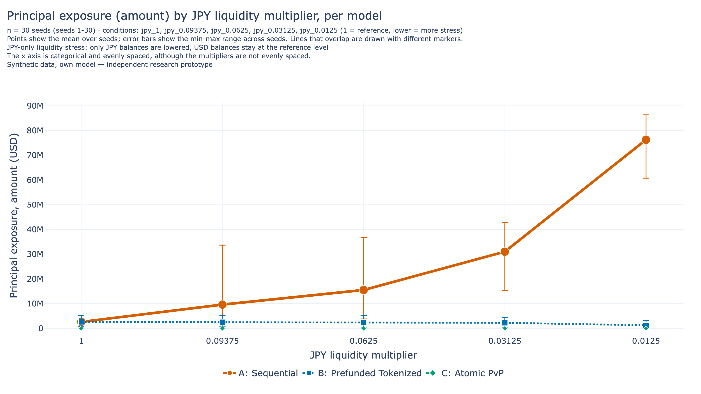

# Policy Considerations for Tokenized USD/JPY Settlement Infrastructure

### A policy brief from an independent simulation study on synthetic data

- Independent research prototype.
- Synthetic data only; nothing here describes a real bank, market or system.
- No institution (BIS, BoJ, CLS, OSFI, Bank of Canada or any other) has reviewed, approved or endorsed it.

Date: 2026-11-14. Version: 1.0 (release candidate).

Methods, decision rules and full results are in the research report, `research/report.md`. This brief makes no recommendation. It lists issues, trade-offs seen in the model, and what would need testing.

## 1. Key Findings

The study compares three simplified ways to settle a USD/JPY trade: A Sequential, B Prefunded and C Atomic PvP. Unless stated otherwise, every result below uses synthetic data, 30 seeds (1 to 30), 2 banks (5 and 10 only in the H3 sensitivity runs), 1% injected failure and a 60 s delay. Liquidity stress lowers JPY only; USD stays at the reference level.

1. **Baseline (ample liquidity).** Success Rate was 0.9905 in all three models. Partial Rate was 0.009533 in A and B and 0 in C. Principal Exposure was 2,596,000 USD in A and B and 0 in C. C's exposure of 0 holds by design. It is a correctness check, not evidence.
2. **Prefunding is not atomicity.** B reserves funds, but an injected second-leg failure still leaves a one-leg-only (partial) transaction, as in A. C validates both legs and commits once. A balance check alone does not make settlement atomic.
3. **Atomic PvP did not remove liquidity risk in these models.** At the lowest JPY multiplier (0.0125), Success Rate was 0.7727 for A and C and 0.5278 for B. Failure Rate was 0 / 0.4669 / 0.2273 (A / B / C) and Partial Rate was 0.2273 / 0.005333 / 0. Principal Exposure was 76,250,000 / 1,230,000 / 0 USD. C had no partial transactions but still failed when funds were short. This is consistent with the Basel Committee statement that PvP is designed to eliminate principal risk but not liquidity risk [BCBS-1]; neither validates the other.
4. **Exposure gap between A and B (H1b, recorded as supported).** B had lower Principal Exposure than A in all 30 seeds at the three active levels (multipliers 0.0625, 0.03125 and 0.0125). Caveat: the direction can be anticipated from the reservation rule, so the verdict is not independent evidence. The size of the gap is the information: at multiplier 0.0125 it was 76,250,000 USD for A against 1,230,000 USD for B (item 3).
5. **Delay raises B's liquidity proxy (H2, recorded as supported).** B's Peak Liquidity Proxy was 40,070,000 USD at 0 s, 42,210,000 USD at 60 s and 53,870,000 USD at 300 s. A stayed at 40,070,000 USD across delays. The mean gap-at-300-s minus gap-at-0-s was 13,792,920.307 USD, positive in 30 of 30 seeds. Caveat: the direction follows largely from the reservation rule, and the proxy ignores netting and credit and counts reserved funds as unavailable. Gross Prefunding is not Peak Liquidity.
6. **What is not settled.** H4a (A and C differ in how Success Rate falls under stress) was recorded as not supported: A and C had equal Success Rate in all 150 level-seed pairs. This may follow from the model rules (a proposed reading, not verified). H3 gave 0 supported, 2 not supported and 7 inconclusive verdicts, with no pooled verdict. The 2 "not supported" verdicts may follow from model rules, and the grid is coarse between 1 and 0.09375. H4b was recorded as inconclusive. H1a is descriptive only and has no verdict.

Exploratory only, with no verdict: B's Success Rate fell faster than A's and C's at low JPY levels. A proposed, untested reading is that reservations hold JPY for in-flight transactions and block later arrivals.

*Figure F6. Exp3, amount-based Principal Exposure by model against JPY multiplier, failure 1%, 60 s, 30 seeds; error bars are min to max over seeds. Synthetic data, own model. C's exposure of 0 holds by design (correctness check).*

## 2. Implications for Central Banks

- **Settlement asset.** The model does not distinguish central bank money from commercial bank deposits. Each bank simply holds USD and JPY balances. The results therefore cannot say whether the choice of settlement asset changes principal exposure or liquidity demand. This raises the question of how each asset type would interact with reservation and atomic commit, and it would need separate analysis.
- **Platform design.** In the model, the design without a one-leg-only state (C) and the design that reserves funds early (B) differ in what they ask of participants. The Bank of Japan has written that if liquidity needs rose substantially on a common platform, participants would likely avoid using it for FX settlement [BOJ-7]. That is the Bank's view, not a result of this study. It raises the question of whether a platform's liquidity need, as well as its risk reduction, would matter to participants. This study can only measure the model proxy for that need.
- **Two measures.** Principal Exposure and liquidity demand are different quantities; in these models a design can do well on one and not the other.

## 3. Liquidity Management

- **Funds locked during delay.** In B, funds for both legs are reserved at arrival, so a longer delay keeps them unavailable for longer; B's proxy rose with delay (Key Finding 5). Whether real intraday practice would show the same pattern would need to be tested.
- **Reuse of funds.** The exploratory result for B may reflect reserved funds that cannot be reused while a transaction is in flight (proposed reading, not tested).
- **Atomic PvP still needs funds.** C needs both legs funded at commit, so it still failed when JPY was short (Key Finding 3).
- **Not modelled.** Netting, credit lines and intraday facilities are absent, so real liquidity needs may differ. The proxy is not a measure of any real institution's liquidity.

## 4. Settlement Finality

- Completion of a transaction in the simulation is not legal settlement finality. Legal finality depends on legal and regulatory frameworks that this study does not model.
- BIS itself separates workflow-level atomicity (lock, then commit or cancel) from legal finality, and says its legal analysis does not make definitive legal determinations [BIS-2].
- This raises the question of how a technically atomic workflow would align with the legal finality rules of each jurisdiction involved. That question needs legal analysis, which a simulation cannot provide.

## 5. Operational Resilience

The model has only independent per-transaction failure draws (1% by default) and a fixed delay. It has none of the following, which are open issues:

- **Participant exit.** No bank leaves or becomes unable to pay.
- **Fallback processing.** There is no contingency path, queue or retry.
- **Correlated failure.** Real failures may be correlated; here each draw is independent.

In the model, an injected failure leaves a partial in A and B and a failed transaction in C. Whether that difference persists when failures are correlated, or when a fallback exists, would need to be tested. H4b (combined delay and JPY stress) was recorded as inconclusive, so the runs do not say how delay and stress interact.

## 6. Further Testing

The following would need new runs and are not part of these results:

1. A finer grid between multipliers 1 and 0.09375.
2. Stress on USD, or on both currencies.
3. Netting and credit lines.
4. Correlated failures and participant exit.
5. A transaction-level check of the A = C equality and of the arrival result.
6. Legal finality analysis using real legal frameworks.
7. Comparison with primary data from real infrastructure, if such data become available.

**What this brief does not say.** It does not say that any design is better for real markets, that any institution supports a design, or that smart-contract completion equals legal finality. Verdicts are recorded outcomes of tested claims, not conclusions.

## References

Source IDs follow `research/sources.md`.

- [BCBS-1] Basel Committee on Banking Supervision, *Supervisory guidance for managing risks associated with the settlement of foreign exchange transactions*, February 2013. https://www.bis.org/publ/bcbs241.htm
- [BIS-2] BIS Innovation Hub, *Project Agorá: a shared programmable platform for wholesale cross-border payments*, 27 May 2026. https://www.bis.org/publ/othp110.htm
- [BOJ-7] Bank of Japan, *Payment and Settlement Systems Report*, September 2024 (Chapter VII only read). https://www.boj.or.jp/en/research/brp/psr/psr240910.htm
