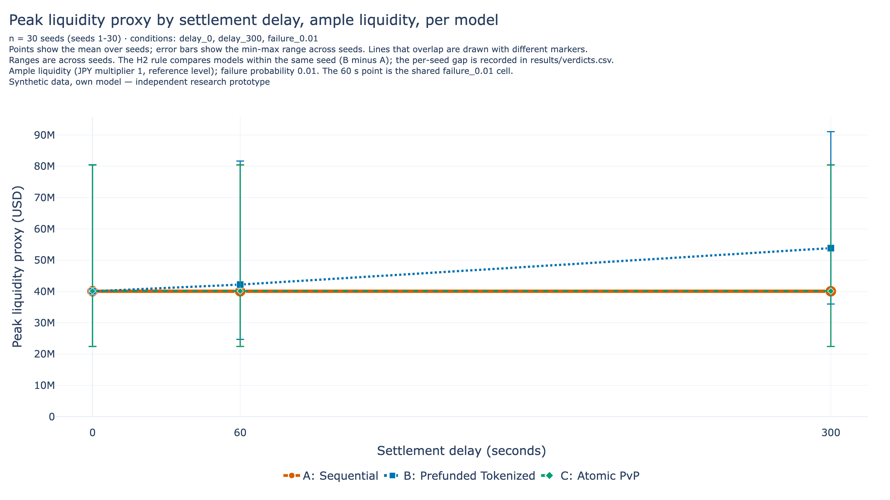
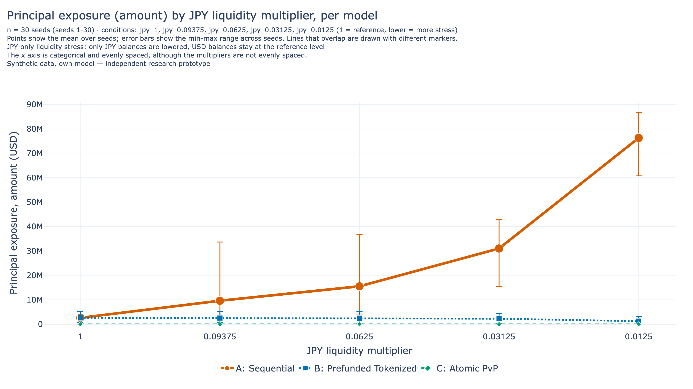
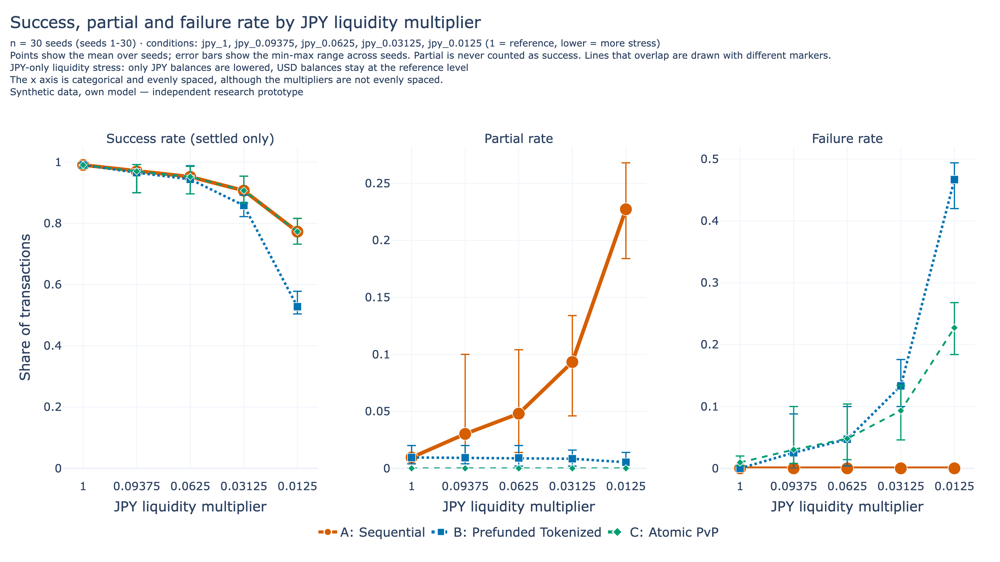

# USD/JPY Tokenized Settlement Lab

### Comparing three settlement designs on synthetic data

Presenter: ssnoa4o · 2026-11

*Independent research prototype · synthetic data · not reviewed or endorsed by BIS, BoJ, CLS or any institution*

<!-- notes: Hello, I am ssnoa4o. This talk presents a small simulation of USD/JPY settlement, comparing three simplified designs on the same synthetic transactions. Three points first. This is an independent research prototype. The data are synthetic. No institution has reviewed or endorsed it. I will keep results, interpretation and open policy questions separate. Let me start with the problem we are looking at. -->

---

# The Problem: Two Different Risks

- An FX trade has two payment legs, for example USD and JPY
- **Principal risk:** one leg settles and the other does not (Herstatt, 1974) [CLS-4]
- **Liquidity risk:** a bank cannot pay on time because a counterparty has not paid yet [OSFI-1]
- PvP is "designed to eliminate principal risk, but will not eliminate a bank's replacement cost risk or liquidity risk" [BCBS-1]
- CLS says its service cuts funding needs by more than 96%. That is CLS's own claim; we did not test it [CLS-3]

*Sources: [BCBS-1] Basel Committee 2013; [OSFI-1]; [CLS-3]; [CLS-4]. Full list in the report.*

<!-- notes: An FX trade has two payment legs. Settlement risk appears when one leg can settle without the other. CLS, in source CLS-4, describes Herstatt risk, after the 1974 failure of Herstatt Bank, as paying the currency you sold without receiving the currency you bought. That is principal risk, the loss of the full value of the trade. Liquidity risk is different. A bank may be unable to make its own payments on time because a counterparty has not paid yet, even if that counterparty is not insolvent and may pay later. The Basel Committee guidance from 2013 says payment-versus-payment arrangements are designed to eliminate principal risk, but not liquidity risk. CLS says its service reduces funding needs by more than ninety-six percent. I label that as CLS's own claim. I did not test it, and I do not use it as an input. So for this study, a liquidity measure belongs next to principal exposure. That reading is mine, not a finding from the sources. The next slide asks why tokenization is being discussed at all. Every later result uses synthetic data. -->

---

# Why Tokenization?

- BIS Project Agorá explores a shared programmable platform with tokenised deposits and tokenised central bank reserves. This is BIS's own description [BIS-2]
- BIS describes a lock, then commit-or-cancel workflow for both legs [BIS-2]
- BIS says its "atomicity" is about the workflow, not legal settlement finality [BIS-2]
- Bank of Japan: tokenized deposits are among the candidates for future foundations (Himino) [BOJ-5]. This is the Bank's view
- Gap: in the parts we read, no USD/JPY PvP test or quantified liquidity result was found

*Sources: [BIS-2] Agorá report (read in part); [BOJ-5] Himino speech, 16 May 2026; [BOJ-7] PSS Report 2024.*

<!-- notes: BIS Project Agorá explores a shared programmable platform with tokenised deposits and tokenised central bank reserves. That is how BIS describes its own project. BIS describes a workflow where both legs are locked, then both commit or both cancel. It also says its atomicity refers to the workflow, not legal settlement finality. The Bank of Japan has discussed tokenized deposits with tokenized reserves as candidates for future foundations, and has written that high liquidity needs could keep participants away from a common platform, in source BOJ-7. Those are the Bank's views, not my results. Here is the gap. In the parts of the Agorá report I read, I found no USD/JPY PvP test or quantified liquidity result. So I built a small simulation. -->

---

# Three Settlement Models

| Model | When funds are checked | When legs move | Can one leg complete alone? |
|---|---|---|---|
| A Sequential | When each leg runs | USD at arrival, JPY after the delay | Yes |
| B Prefunded | Both legs reserved at arrival | Legs run as in A | Yes, if the second leg fails |
| C Atomic PvP | Both legs validated at commit | Both applied in one step | No |

**Prefunding is not atomicity. A balance check alone does not make settlement atomic.**

*Simplified models. The mapping to real arrangements is our own interpretation.*

<!-- notes: Here are the three models, always in the same order. Model A, Sequential. The USD leg runs at arrival, the JPY leg after a delay, and funds are checked when each leg runs. So one leg can complete alone. Model B, Prefunded. Funds for both legs are reserved at arrival. If a reservation is not possible, nothing moves. After that the legs run as in A, so an injected failure at the second leg still leaves one leg done. Model C, Atomic PvP. After the delay both legs are validated on the current state, then both are applied in one step. If anything fails, neither leg is applied. The key message: prefunding and atomicity are different concepts. Prefunding secures funds in advance. Atomicity makes two legs indivisible. A balance check alone does not make settlement atomic. I read A as similar in spirit to non-PvP settlement, B to prefunding and C to PvP. That mapping is my own interpretation. No institution states it. These are simplified models, not copies of any real system. Notice that only C removes the one-leg-only state. -->

---

# Research Methodology

**Question:** Under simplified models and synthetic USD/JPY transactions, how do three designs differ in principal exposure, liquidity demand, time and stress behaviour?

| Hypothesis | Claim tested | Metric |
|---|---|---|
| H1a, H1b | Exposure: A and B vs failure rate (H1a); B lower than A under JPY stress (H1b) | Principal Exposure |
| H2 | B minus A gap grows with delay | Peak Liquidity Proxy |
| H3 | L\* differs by volume, banks, arrival | L\* |
| H4a, H4b | JPY stress changes Success Rate (A vs C); delay stress at JPY 0.09375 changes exposure (A vs B) | Success Rate; Principal Exposure |

- Decision rules fixed before the runs; outcomes: supported / not supported / inconclusive
- 30 seeds (1 to 30), same transactions for all models, JPY-only liquidity stress
- Peak Liquidity Proxy is not Peak Liquidity. Gross Prefunding is not Peak Liquidity

<!-- notes: The central question is on the slide: how do three designs differ in principal exposure, liquidity demand, settlement time and stress behaviour? The hypotheses are claims to test, not conclusions. H1a is descriptive only. H1b says B has lower exposure than A under JPY stress. H2 says the gap in the Peak Liquidity Proxy between B and A is larger at a long delay. H3 asks whether the lowest liquidity level giving 95 percent success, called L star, differs by volume, banks or arrival pattern. H4a asks whether JPY stress changes Success Rate differently in A and C. H4b asks whether delay stress, at JPY multiplier 0.09375, changes Principal Exposure differently in A and B. Decision rules were fixed in a file before the main runs. Each outcome is recorded as supported, not supported or inconclusive. These rules are range and sign rules, not statistical tests. That limits how strongly any verdict can be read. We use 30 random seeds, and within a seed all three models see the same transactions. The runs use a base case of 500 transactions between 2 banks, with a 60 second settlement delay and 1 percent injected failure. Sizes are design values, not estimates of any real market. All liquidity stress lowers JPY only; USD stays at its reference level. Results are means over seeds unless I say otherwise. Two warnings about terms. The Peak Liquidity Proxy is the largest drawdown of available balance. It ignores netting and credit, so it is a proxy, not Peak Liquidity. Gross Prefunding is also not Peak Liquidity. They measure different things. I will show each verdict next to its caveat. -->

---

# Prototype Demonstration

Streamlit dashboard, runs the real engine locally (no network, no external API)

1. **Baseline:** compare A Sequential, B Prefunded, C Atomic PvP
2. **JPY shortage:** set the multiplier to 0.0625
3. **Look at C:** no one-leg-only state (by design, a correctness check), but it still fails when funds are short
4. **Back to recorded results:** CSV and figures behind the slides

*Live runs are exploratory. Verdicts come from the recorded runs (30 seeds), not from the demo. Synthetic data.*

<!-- notes: Now the live demo, about three minutes. The dashboard is a Streamlit app. It calls the same simulation engine as the experiments, locally, with no network and no external service. It is not a mock-up with fixed values. Step one. I open the dashboard and say again that this is a research prototype on synthetic data. I run the Baseline and compare the three models. Step two. I lower the JPY liquidity multiplier to 0.0625 and run again. We watch settled, partial and failed counts change. Step three. I look at Model C. By design it has no one-leg-only state, so no partial transactions and no principal exposure; that is a correctness check, not a finding. Yet it still fails when JPY is short. Principal risk and liquidity risk are different problems. Step four. I go back to the recorded results and the CSV files, and show that the slide numbers come from those files. An important note: live runs are exploratory. Hypothesis verdicts come only from the recorded runs with 30 seeds. -->

---

# Liquidity Results

{.fig}

*Ample liquidity, failure 1%, delays 0, 60, 300 s, 30 seeds, min to max bars. Synthetic data, own model.*

- **Result:** B's Peak Liquidity Proxy was 40,070,000 USD at 0 s, 42,210,000 at 60 s, 53,870,000 at 300 s. A stayed at 40,070,000 (4 significant figures)
- **H2 recorded as supported** (gap at 300 s minus gap at 0 s positive in 30 of 30 seeds; mean 13,792,920.307 USD)
- **Caveat:** direction follows from the reservation rule; proxy ignores netting and credit

<!-- notes: This figure shows the Peak Liquidity Proxy against settlement delay, at ample liquidity. The result is on the slide: in Model B the proxy rose with delay, while A stayed flat. H2 is recorded as supported, because the B minus A gap at 300 seconds minus the gap at 0 seconds was positive in every seed. Now the caveats. Interpretation: B reserves funds for both legs at arrival, so a longer delay keeps funds unavailable for longer. That direction can be anticipated from the reservation rule, so the verdict is not independent evidence. The size of the gap is the useful information. The proxy also ignores netting and credit and counts reserved funds as unavailable by definition. The error bars overlap across models, so the verdict uses the paired per-seed gap, which is not plotted. -->

---

# Settlement Risk Results

{.fig}

*Amount-based exposure, JPY multipliers 1 to 0.0125, failure 1%, 60 s, 30 seeds, min to max bars. Synthetic data, own model.*

- **Baseline:** Success Rate 0.9905 in all models; exposure 2,596,000 USD in A and B, 0 in C
- **H1b recorded as supported:** at 0.0125, A 76,250,000 vs B 1,230,000 USD
- **Caveat:** direction anticipated from the reservation rule. C = 0 holds by design, a correctness check, not evidence

<!-- notes: This figure shows principal exposure, the sum of USD amounts in one-leg-only transactions, as JPY liquidity falls. At baseline, all three models had the same success rate, but only A and B carried exposure. Under stress, H1b is recorded as supported: B had lower exposure than A in every seed at the active stress levels, and the gap at the lowest multiplier is on the slide. Now the caveats. C's zero exposure holds by design, because C has no one-leg-only state. That is a correctness check, not evidence. The direction of H1b can also be anticipated from the reservation rule, so the verdict is not independent evidence. The size of the gap is the information. This is JPY-only stress in a simplified model with synthetic data. -->

---

# Stress Testing

{.fig}

*JPY multipliers 1 to 0.0125, failure 1%, 60 s, 30 seeds, min to max bars. Synthetic data, own model.*

- **H4a not supported:** A and C had equal Success Rate in all 150 pairs; may follow from model rules
- **H4b inconclusive:** mixed signs at 300 s, reversal at 60 s
- **H3:** 0 supported, 2 not supported, 7 inconclusive (coarse grid)
- C still failed: Failure Rate 0.2273 at multiplier 0.0125

<!-- notes: This figure shows success, partial and failure rates as the JPY multiplier falls. H4a is recorded as not supported, because A and C had equal Success Rate in every level and seed pair. Caveat: with USD at its reference level, both may fail exactly when the JPY leg is short, so this equality may follow from model rules. That is a proposed reading, not verified. H4b, delay stress at JPY multiplier 0.09375, is recorded as inconclusive: at 300 seconds the paired difference was positive in 8 seeds, negative in 1 and zero in 21, and the 60 second check was a reversal. The methodology anticipated little or no difference, because amount-based exposure ignores delay directly. For H3, most of the nine verdicts were inconclusive, and none was supported. The grid is coarse between the top two levels, so each is a verdict on this grid only. The two not supported verdicts may also follow from model rules. C had no partial transactions but still failed when funds were short. All stress here lowers JPY only. -->

---

# Policy Implications

**What the runs record**

- At multiplier 0.0125: Success Rate 0.7727 in A and C; C Failure Rate 0.2273, A Partial Rate 0.2273, B Failure Rate 0.4669 (means, 30 seeds)
- C has no one-leg-only state by design (a correctness check), yet it still failed when JPY was short

**Interpretation (tentative, these models only)**

- Principal exposure and liquidity demand behave as different quantities

**Open policy questions (no recommendation)**

- How would settlement asset type interact with reservation and atomic commit?
- Would a platform's liquidity need matter to participants, as [BOJ-7] suggests?
- How would an atomic workflow align with legal finality rules?

<!-- notes: This slide follows the policy brief and makes no recommendation. I keep three parts apart. First, what the runs record. A and C had the same Success Rate; what A recorded as partial, C recorded as failed. C has no one-leg-only transactions by design, which is a correctness check, yet it still failed when JPY was short. Second, interpretation, tentative and limited to these simplified models. Principal exposure and liquidity demand behave as different quantities. This is consistent with the Basel Committee statement on PvP, but neither validates the other. Third, open questions. My model does not distinguish central bank money from commercial bank deposits, so it cannot say how asset type interacts with reservation and atomic commit. The Bank of Japan has written that high liquidity needs could deter participants. That is the Bank's view. And a simulation cannot say how an atomic workflow aligns with legal finality in each jurisdiction. -->

---

# Limitations and Future Research

- Simplified models: no netting, credit, queues, retries or price moves
- Synthetic data; one seed set; ranges are not confidence intervals
- Stress lowers JPY only; H3 grid is coarse
- Smart-contract-style completion is not legal settlement finality
- In these models, Atomic PvP removes the one-leg-only state, not liquidity risk
- **Next tests:** finer grid; USD or two-currency stress; netting and credit; correlated failures

<!-- notes: The limitations matter. The models are simplified, with no netting, credit, queue or retry. The data are synthetic, and the ranges are not confidence intervals. Stress lowers JPY only. Simulated completion is not legal settlement finality, and in these models atomic PvP removes the one-leg-only state but not liquidity risk. Next tests need new runs: a finer grid, other stress types, netting and credit, and correlated failures. -->

---

# Conclusion

| Item | Recorded outcome |
|---|---|
| H1a | descriptive only |
| H1b | supported |
| H2 | supported |
| H3 | 0 supported, 2 not supported, 7 inconclusive |
| H4a | not supported |
| H4b | inconclusive |

- **Interpretation, under these models:** principal risk and liquidity need are different quantities
- Verdicts carry caveats: several directions follow from model design
- Code and data: github.com/ssnoa4o/usd-jpy-tokenized-settlement-lab
- **Next:** finer grid, USD stress, netting, legal finality

<!-- notes: Here are the recorded outcomes. Several directions follow from model design, so the sizes carry more information than the verdicts. As an interpretation, under these simplified models, principal risk and liquidity need are different quantities. This is not a recommendation and says nothing about real markets or legal finality. The code and data are in the public repository shown on the slide. Thank you; I am happy to take questions. -->
