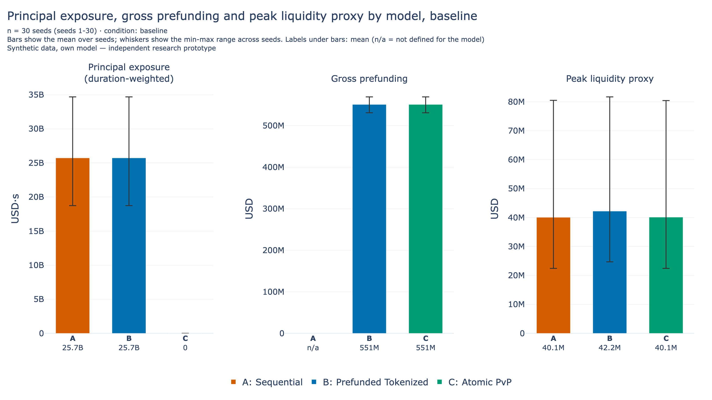
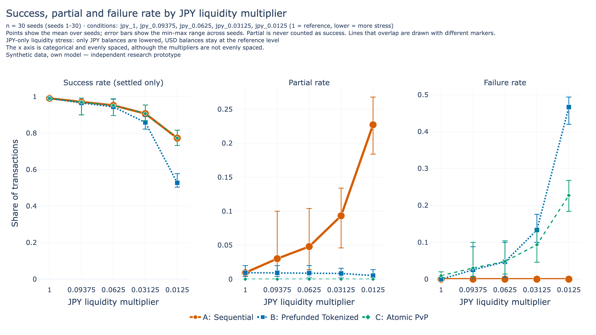
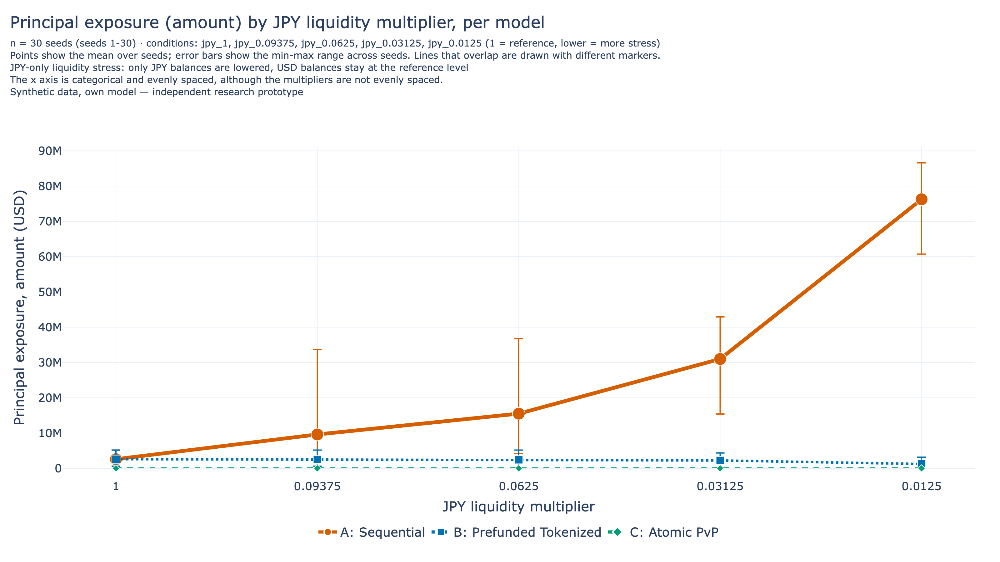
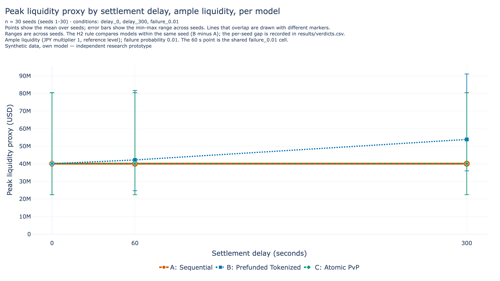
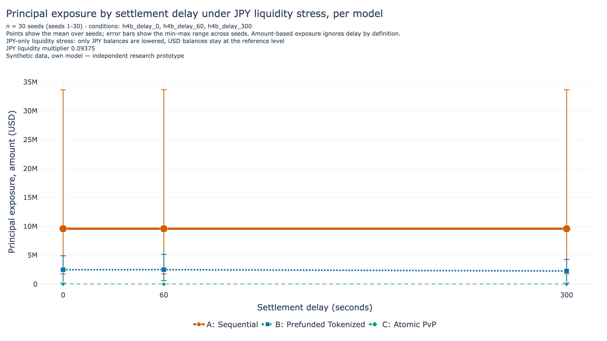

# Liquidity Efficiency and Settlement Risk in Tokenized USD/JPY Foreign Exchange Settlement

### An independent simulation study on synthetic data

- Independent research prototype.
- Synthetic data only; nothing here describes a real bank, market or system.
- No institution (BIS, BoJ, CLS, OSFI, Bank of Canada or any other) has reviewed, approved or endorsed it.

Date: 2026-11-14. Version: 1.0.

## 1. Abstract

This study compares three simplified ways of settling a USD/JPY foreign exchange trade: Model A Sequential, Model B Prefunded and Model C Atomic PvP. In A, the two payment legs run one after the other, so one leg can complete alone. In B, funds for both legs are reserved when the trade arrives. In C, both legs are checked and then committed together, or not at all. All three models were run on the same synthetic transactions with 30 random seeds (1 to 30). We measured principal exposure, liquidity demand, success, partial and failure rates, and settlement time. Each hypothesis was tested under a decision rule that was fixed before the runs.

The runs record the following. H1a is descriptive only and has no verdict. H1b (B has lower principal exposure than A under JPY liquidity stress) is supported, and H2 (the B minus A gap in the Peak Liquidity Proxy grows with delay) is supported. H4a (A and C differ in how their success rate falls under liquidity stress) is not supported, and H4b (delay stress and principal exposure) is inconclusive. H3 gives nine verdicts: none supported, two not supported, seven inconclusive, and no pooled verdict.

These results need caveats. The direction of H1b and H2 can be anticipated from the reservation rules, so those verdicts are not independent evidence; the size of each gap is the useful information. The equality of A and C behind H4a, and the two H3 "not supported" verdicts, may follow from the model rules (a proposed reading, not verified). The H3 grid is coarse between multipliers 1 and 0.09375, and all liquidity stress lowers JPY only. Smart-contract-style completion in the simulation is not legal settlement finality. Atomic PvP as modelled removes the one-leg-only state but not liquidity risk: Model C still fails when funds are short. The models are simplified and the data are synthetic. This paper makes no recommendation.

## 2. Background and Literature Review

This section reports what sources say. Our model results are in sections 5 and 6, and the sources do not validate them. Facts that depend on time are given as of 13 November 2026.

**Settlement risk concepts.** An FX trade has two payment legs, for example USD and JPY. Settlement risk arises when one leg can settle without the other. CLS describes Herstatt risk, named after the 1974 failure of Herstatt Bank, as the risk of paying the currency sold without receiving the currency bought [CLS-4]. OSFI's glossary, which says it is based on a Basel Committee paper, defines principal risk as the risk of outright loss of the full value of a transaction when the counterparty fails to settle. It defines liquidity risk as the risk that a bank cannot make payments due to a shortage of liquidity because a counterparty does not settle when due, and notes that this does not imply insolvency, because the counterparty may settle later [OSFI-1]. The Basel Committee guidance (2013) says banks should eliminate principal risk by using payment-versus-payment (PvP) "where practicable". It also says PvP arrangements are "designed to eliminate principal risk, but will not eliminate a bank's replacement cost risk or liquidity risk" [BCBS-1]. OSFI adds that PvP arrangements do not guarantee settlement [OSFI-1]. For this study, the point is that a liquidity measure belongs next to principal exposure. That reading is ours.

**Existing infrastructure.** CLS says it settles trades simultaneously through a PvP system with multilateral netting, and claims that its service cuts funding requirements by more than 96% [CLS-3]. It lists 18 eligible currencies including USD and JPY [CLS-2], and its home page reports more than USD 8 trillion settled on an average day, with no reference date [CLS-1]. These are CLS's own claims; we did not test them and do not use them as inputs or targets. CLS also says that reliance on non-PvP settlement fell from 85% to 22% of FX traffic over 25 years [CLS-4]. Bank of Japan publications say that a significant part of yen FX payments moved from the domestic FXYCS system to CLS after 2002 [BOJ-8] and that CLS yen settlements use BOJ-NET home accounts [BOJ-10]. The Bank of Japan wrote in 2024 that FX is settled with a relatively small amount of intraday liquidity because CLS provides a kind of multilateral netting effect, and that if liquidity needs rose substantially on a common platform, market participants "would likely avoid using the platform for foreign exchange settlement purposes" [BOJ-7]. That is the Bank's view, not a test result. It is one reason we track liquidity demand as well as risk.

**Tokenization initiatives.** BIS Project Agorá explores whether a shared, programmable platform that combines tokenised commercial bank deposits and tokenised central bank reserves is desirable, feasible and viable for wholesale cross-border payments [BIS-1, BIS-2]. The BIS media release of 27 May 2026 names seven central banks (including the Bank of Japan) and more than 40 private financial institutions, says the Bank of Canada has since joined, and says that atomic settlement is achievable across currencies and jurisdictions; that is BIS's own claim [BIS-3]. The Bank of Canada's release describes it as joining seven other central banks in the project [BOC-1]. BIS describes a lock, commit-or-cancel workflow in which both legs of a PvP payment commit together or cancel together [BIS-2]. The BIS project page reports a test phase in July 2026 [BIS-1]. BIS also says that its use of "atomicity" refers to the workflow and is not a statement about legal settlement finality, and that its legal analysis does not make definitive legal determinations [BIS-2]. In the parts of the report reviewed for this study, we did not find a USD/JPY PvP test or a quantified liquidity or settlement-risk result. BIS says benefits "will only be quantifiable when applied to more realistic conditions", and lists liquidity demands from gross settlement as a future topic [BIS-2].

**Bank of Japan.** In a speech on 16 May 2026, Deputy Governor Himino listed tokenized deposits with tokenized central bank reserves among candidates for foundations of the future monetary system, alongside stablecoins and CBDC [BOJ-5]. According to a speech by Executive Director Kamiyama (29 May 2026), the Bank announced in March 2026 a plan to explore tokenized current account deposits [BOJ-6]. We did not find the March announcement itself. Neither speech discusses FX settlement or PvP.

**How this study differs.** These are real arrangements or experiments. Our work is a small Python simulation on synthetic data. It does not connect to any platform, reproduce CLS, model legal finality or replicate Agorá. We read A as similar in spirit to non-PvP settlement, B to prefunding and C to PvP; this mapping is our own interpretation and no institution states it.

## 3. Research Questions and Hypotheses

**Central question.** Under simplified models and synthetic USD/JPY transactions, how do three settlement designs differ in principal exposure, liquidity demand, settlement time and behaviour under stress?

The hypotheses are claims to test, not conclusions. Each is recorded as supported, not supported or inconclusive. Table 1 lists them with the decision rule. The rules were fixed in `research/hypotheses.md` before the main runs and were not changed afterwards.

**Table 1. Hypotheses and decision rule (fixed before the runs).**

| Item | Claim | Primary metric | Rule |
|---|---|---|---|
| H1a | Exposure in A and B does not fall as failure probability rises | Principal Exposure (amount) | Descriptive, no verdict (guaranteed by the injection rule; size reported) |
| H1b | B lower than A under JPY stress | Principal Exposure (amount) | Paired rule, active levels only |
| H2 | B minus A proxy gap larger at 300 s than at 0 s | Peak Liquidity Proxy | Paired rule |
| H3 | L\* differs between factor levels | L\* | Range rule, 9 verdicts |
| H4a | A and C differ in success-rate change under JPY stress | Success Rate | Highest stress decides; milder levels check for reversal |
| H4b | A and B differ in exposure change under delay stress | Principal Exposure (amount) | Active check first; then as H4a (300 s decides, 60 s checks) |

The common decision rule for model comparisons is the paired rule, applied to the per-seed difference (same seed, same transactions). A claim is not supported if the two models are identical in every seed, or if the difference has the opposite sign in every seed. It is supported if the difference has the predicted sign in every seed and its mean is not zero. Otherwise it is inconclusive. For H3 the factor levels use different transactions, so a range rule applies: supported if the L\* ranges over 30 seeds do not overlap (touching counts as overlapping), not supported if L\* is identical in every seed at both levels, inconclusive otherwise. A comparison where any seed has L\* at the lowest grid level, or "not reached", would be censored and inconclusive. For H1b only "active" levels count, where Model A has a partial with insufficient funds in every seed. For H4a and H4b the highest stress level decides: supported if the paired difference of the change has the same sign in every seed with a non-zero mean and no milder level has a mean of the opposite sign (a mean of exactly 0 is not a reversal); not supported if the change is identical in every seed at the highest stress; inconclusive otherwise, including mixed signs at the highest stress or a reversal at a milder level. H4b is first checked for being informative: A must have a partial with insufficient funds in some seed in its cells, otherwise it is inconclusive (untestable). Outcomes that follow from model rules are treated as correctness tests, not evidence. These rules are range and sign rules, not statistical tests. `hypotheses.md` already states that the directions of H1b and H2 are largely design-driven (section 5 gives the reasons); for both, the size of the gap is the information.

## 4. Simulation Methodology

**Models.** All models give each bank separate USD and JPY balances, and every transaction has a USD payer and a JPY payer. Models are always listed in the same order: A Sequential, B Prefunded, C Atomic PvP.

- A Sequential: the USD leg runs at arrival and the JPY leg after a delay. Funds are checked when each leg executes. One leg can complete alone.
- B Prefunded: funds for both legs are reserved at arrival. If a reservation is not possible, nothing moves. Legs then run as in A. An injected failure at the second leg still leaves one leg done.
- C Atomic PvP: at arrival plus the delay, both legs are validated on the current state, then both are applied in one step. On any failure neither leg is applied.

Prefunding and atomicity are different concepts. Prefunding secures funds in advance. Atomicity makes two legs indivisible. A balance check alone does not make settlement atomic.

**Synthetic data.** Each transaction has a size drawn uniformly between USD 100,000 and USD 1,000,000, a fixed rate of 150.00, and a random ordered pair of banks. Base case: 500 transactions, 2 banks, one arrival every 10 s ("sequential"), settlement delay 60 s, failure probability 1%, and reference balances of USD 100,000,000 and JPY 15,000,000,000 per bank, which proved ample. All values are design values, not estimates of any real market. A burst pattern (10 transactions at once every 100 s) was also run. Each transaction gets one uniform failure draw, shared by all models and all failure levels. In A and B a hit fails the second leg and leaves a partial. In C a hit fails the commit and leaves a failed transaction. There is no queue and no retry.

**States.** A transaction is settled (both legs done), partial (exactly one leg done) or failed (neither). Failure reasons include insufficient funds and technical failure.

**Metrics.**

- Success Rate counts settled transactions only; partial is excluded. Ratios with a zero denominator are not available, not zero.
- Principal Exposure (amount-based) is the sum of USD amounts over partial transactions. A duration-weighted version uses a cut-off W of 3,600 s and is descriptive only, because every partial contributes W regardless of delay.
- Gross Prefunding is the value of both legs reserved (B) or passing validation (C), summed over the run. For C it counts amounts passing validation of both legs, even if the commit then fails with a technical failure. It is not defined for A.
- Peak Liquidity Proxy is the largest drawdown of available balance, summed over banks and currencies, in USD. It is a proxy: it ignores netting and credit and counts reserved funds as unavailable. Gross Prefunding is not Peak Liquidity.
- L\* is the lowest liquidity multiplier at which Success Rate is at least 95% at that level and every higher level.
- Average Settlement Time is the mean over settled transactions. It equals the delay in every model by construction.

**Calibration.** The liquidity grid was set by a calibration run on separate seeds (101 to 110) before any main run. Attempt 1 scaled USD and JPY together and did not produce Model A second-leg shortages. Before any main run, the design was revised to lower JPY only, with USD at the reference, and attempt 2 met its conditions. The grid is JPY multipliers 1, 0.09375, 0.0625, 0.03125 and 0.0125. The H4b level is 0.09375. All "liquidity stress" in this paper therefore means JPY liquidity stress.

**Experiments.** Table 2 lists the main runs. All use seeds 1 to 30 and the three models on shared transactions.

**Table 2. Experiments (30 seeds each; all synthetic).**

| Experiment | Cells | Runs | Code commit |
|---|---|---|---|
| Exp1 Baseline | failure 1% and 0% (sanity), ample liquidity | 2 conditions x 3 models x 30 seeds | 743f1ba |
| Exp3 Liquidity | 5 JPY multipliers, 1% failure, 60 s | Exp3 and Exp4 together: 13 cells, 1,170 runs | 5c3d59b |
| Exp4 Delay / failure | failure 0, 1, 5%; delay 0, 300 s; 3 H4b cells at multiplier 0.09375 | (included above) | 5c3d59b |
| Exp2 x Exp3 | 6 cells (baseline, volume 100, volume 1000, banks 5, banks 10, burst) x 5 multipliers | 2,700 runs | 542043b |

The verdict code was committed before the main runs that use it, and the runner refuses to run on uncommitted code unless told to. Within a seed the three models see the same transactions and the same failure draws. Required tests check that C has no partial and no exposure, that a failed C transaction leaves every balance unchanged, and that total balances never change.

## 5. Experimental Results

All numbers are means over 30 seeds from `results/*.csv` unless a range is given. Ranges are [min, max] over seeds, not confidence intervals. Result sentences restate the files; interpretation is marked separately.

### 5.1 Baseline (Exp1, descriptive only)

Exp1 has no hypothesis verdict. Table 3 gives the baseline with 1% injected failure and ample liquidity (no insufficient funds occurred in any run).

**Table 3. Baseline, failure 1%, delay 60 s, ample liquidity (mean over 30 seeds).**

| Metric | A Sequential | B Prefunded | C Atomic PvP |
|---|---|---|---|
| Success Rate | 0.9905 | 0.9905 | 0.9905 |
| Partial Rate | 0.009533 | 0.009533 | 0 |
| Failure Rate | 0 | 0 | 0.009533 |
| Principal Exposure (USD) | 2,596,000 | 2,596,000 | 0 |
| Gross Prefunding (USD) | n/a | 5.512e8 | 5.512e8 |
| Peak Liquidity Proxy (USD) | 4.007e7 | 4.221e7 | 4.013e7 |

*Gross Prefunding for C counts amounts passing validation of both legs, even if the commit then fails with a technical failure. n/a means not defined for A. Gross Prefunding is not Peak Liquidity.*



*Figure F1. Exp1 baseline, failure 1%, 30 seeds; bars are means and error bars are min to max over seeds. Exposure here is duration-weighted (USD-seconds, W = 3,600 s), unlike the amount-based exposure in Table 3. Synthetic data, own model. C's exposure of 0 holds by design (correctness check).*

Result: all three models have the same Success Rate of 0.9905, because a transaction hit by the injected failure is not settled in any of them. The models differ in how those transactions are recorded (partial in A and B, failed in C) and in Principal Exposure. Exposure across seeds ranges from 605,800 to 5,169,000 USD in A and B, partly because the number of injected failures per seed varies from 2 to 10. Interpretation: under these simplified models, an injected second-leg failure leaves exposure in A and B and none in C. This is the design of the models, not a test of real markets. The duration-weighted values depend on W and are not measured durations.

Correctness checks, not evidence: C has Partial Rate 0 and Principal Exposure 0; A and B have identical Principal Exposure at ample liquidity; Average Settlement Time is 60 s in every model; Gross Prefunding is equal in B and C here because the same transactions are counted. B's Gross Prefunding (5.512e8 USD) is far above its Peak Liquidity Proxy (4.221e7 USD) because they measure different things. H1a is descriptive: mean exposure of A and B was 0 USD at 0% failure, 2,596,141 USD at 1% and 13,604,296 USD at 5% (`results/verdicts.csv`), and C was 0 in every cell. There is no verdict for H1a, and the numbers do not measure how large such exposure would be in real markets.

### 5.2 Liquidity stress (Exp3: H1b and H4a)

Here JPY is lowered and USD stays at the reference. At the lowest JPY multiplier (0.0125), mean Success Rate was 0.7727 for A and C and 0.5278 for B. Failure Rate was 0 for A, 0.4669 for B and 0.2273 for C; Partial Rate was 0.2273 for A, 0.005333 for B and 0 for C. Principal Exposure was 76,250,000 USD for A, 1,230,000 USD for B and 0 for C.



*Figure F2. Exp3, JPY multipliers 1 to 0.0125 (categorical, evenly spaced axis), failure 1%, 60 s, 30 seeds; error bars are min to max over seeds. Synthetic data, own model.*



*Figure F6. Exp3, amount-based Principal Exposure by model against JPY multiplier, failure 1%, 60 s, 30 seeds; error bars are min to max over seeds. Synthetic data, own model. C's exposure of 0 holds by design (correctness check).*

H1b is recorded as supported. B had lower Principal Exposure than A in all 30 seeds at the three active levels (multipliers 0.0625, 0.03125 and 0.0125), with mean differences (A minus B) of 13,068,133.901, 28,761,399.823 and 75,019,582.6613 USD. The level 0.09375 was not active (A had such a partial in 26 of 30 seeds) and is not counted. Caveat: the direction can be anticipated from the reservation rule, so the verdict is not independent evidence about B. Under this grid and these simplified models, the size of the gap may be read as an indication of how much this one mechanism contributes. The result applies to JPY-only stress. In B the shortfall appears mainly as failed rather than partial, and B's Failure Rate is higher than C's at the lowest level; why is not tested (exploratory, see below).

H4a is recorded as not supported. Success Rate of A equals that of C in all 150 (level, seed) pairs of Exp3, so the paired difference of the change is exactly 0 in 30 of 30 seeds at each level. Caveat: with USD at the reference, both A and C may fail to settle exactly when the JPY leg is short, so this equality may follow from the model rules rather than be an empirical finding (proposed reading, not verified). It applies to JPY-only stress and says nothing about a USD shortage or a shortage in both currencies. A and C still differ in how the shortfall is recorded and in Principal Exposure.

Exploratory only (no verdict): B's Success Rate falls faster than A's and C's at low JPY levels. A proposed reading, not tested, is that reservations hold JPY for in-flight transactions and so block later arrivals.

### 5.3 Delay and failure (Exp4: H1a and H2)

At ample liquidity with 1% failure, Peak Liquidity Proxy in B rose with delay: 40,070,000 USD at 0 s (equal to A after rounding to 4 significant figures; the unrounded gap is below), 42,210,000 USD at 60 s, and 53,870,000 USD at 300 s. A stayed at 40,070,000 USD and C at 40,130,000 USD across delays. The B minus A mean gaps were 3,086.3667 USD at 0 s, 2,141,185.1933 USD at 60 s and 13,796,006.6737 USD at 300 s.



*Figure F7. Exp4 delay cells (0, 60, 300 s), ample liquidity, failure 1%, 30 seeds; error bars are min to max over seeds. Synthetic data, own model. The min-max bars overlap across models, while the per-seed paired gap used for H2 is positive in 30 of 30 seeds (`results/verdicts.csv`); the gap itself is not plotted.*

H2 is recorded as supported. The B minus A gap at 300 s minus the gap at 0 s was positive in all 30 seeds, with a mean of 13,792,920.307 USD. Caveat: the direction can be anticipated from the reservation rule, so the size of the gap is the main information, not the verdict. The proxy is partly definitional (reserved funds count as unavailable), ignores netting and credit, and is not Peak Liquidity. Gross Prefunding is also a different quantity.

### 5.4 Volume and banks at ample liquidity (descriptive)

This part is descriptive; no verdict depends on it. At ample liquidity, mean Success Rate was equal in A, B and C within each cell: 0.9905 (baseline, 5 banks, 10 banks, burst), 0.9903 (volume 100) and 0.9904 (volume 1000). Peak Liquidity Proxy of A rose from 17,970,000 USD at volume 100 to 40,070,000 USD at 500 and 54,910,000 USD at 1000. With 2, 5 and 10 banks it was 40,070,000, 66,230,000 and 90,770,000 USD. Interpretation (unverified): the rise with banks may partly reflect per-bank balances, since the proxy sums over every bank.

## 6. Stress Testing

### 6.1 Combined delay and liquidity stress (H4b)

The H4b cells combine JPY multiplier 0.09375 with delays of 0, 60 and 300 s. The active check passed: 78 of 90 A rows had a partial with insufficient funds. At 300 s, the paired difference (A change minus B change in amount-based Principal Exposure) was positive in 8 seeds, negative in 1 and zero in 21, with a mean of 217,165.3537 USD. At 60 s it was positive in 1, negative in 2 and zero in 27, with a mean of -10,988.612 USD, which the code labels a reversal. H4b is recorded as inconclusive. Caveat: amount-based exposure ignores delay directly, so delay can act only through balances, and the methodology anticipated little or no difference. The stress lowers JPY only.



*Figure F4. Exp4 H4b cells, JPY multiplier 0.09375, delays 0, 60 and 300 s, failure 1%, 30 seeds; amount-based Principal Exposure by model; error bars are min to max over seeds. Synthetic data, own model. C's exposure of 0 holds by design.*

Descriptively, B's Success Rate was 0.8883 at 300 s against 0.9698 for A and C in these cells. This is exploratory and not part of the H4b rule.

### 6.2 Sensitivity: H3 and L\*

L\* was computed for each model and seed in six cells (baseline, volume 100, volume 1000, banks 5, banks 10, burst). No seed had L\* at the lowest level, so no comparison was censored; the lowest L\* seen was 0.03125. Table 4 lists the nine pre-fixed H3 verdicts: 0 supported, 2 not supported, 7 inconclusive. There is no pooled H3 verdict.

**Table 4. The nine H3 verdicts (L\* ranges over 30 seeds, in JPY multiplier).**

| Factor | Model | Low / high level | L\* range, low | L\* range, high | Verdict |
|---|---|---|---|---|---|
| Volume | A Sequential | 100 / 1000 | [0.03125, 1] | [0.0625, 1] | inconclusive |
| Volume | B Prefunded | 100 / 1000 | [0.0625, 1] | [0.0625, 1] | inconclusive |
| Volume | C Atomic PvP | 100 / 1000 | [0.03125, 1] | [0.0625, 1] | inconclusive |
| Banks | A Sequential | 2 / 10 | [0.03125, 1] | [0.0625, 1] | inconclusive |
| Banks | B Prefunded | 2 / 10 | [0.0625, 1] | [0.0625, 1] | inconclusive |
| Banks | C Atomic PvP | 2 / 10 | [0.03125, 1] | [0.0625, 1] | inconclusive |
| Arrival | A Sequential | sequential / burst | [0.03125, 1] | [0.03125, 1] | not supported |
| Arrival | B Prefunded | sequential / burst | [0.0625, 1] | [0.0625, 1] | inconclusive |
| Arrival | C Atomic PvP | sequential / burst | [0.03125, 1] | [0.03125, 1] | not supported |

L\* equalled 1 in 1 to 7 of the 30 seeds per model and cell. L\* = 1 means Success Rate was below 95% at the 0.09375 level in that seed. Caveat on the grid: it is coarse between multipliers 1 and 0.09375, so a seed's L\* jumps to 1 when 0.09375 falls just short of 95%. The range top of 1 in every row is partly an effect of the grid, and each verdict is a verdict on this grid, not a statement about the underlying liquidity need. A finer grid was not run. Caveat on the two "not supported" verdicts: for A and C, L\* was identical at sequential and burst arrival in all 30 seeds. A possible reason is that burst changes only arrival times and the order of payments within each currency is unchanged, so the balances behave the same. This reading is unverified; the verdicts may follow largely from the model rules. For B, L\* was equal in 22 of 30 seeds and the verdict is inconclusive. For volume and banks, L\* was equal in only 10 to 16 seeds (11 to 13 for B), and these runs do not record whether volume or the number of banks changes L\*. Liquidity is set per bank, so adding banks also adds total liquidity; the banks factor is not a pure participant effect. All of this is JPY-only stress.

### 6.3 Variability across seeds

All ranges are min to max over 30 seeds, not confidence intervals. Spread is wide for some metrics: baseline Peak Liquidity Proxy of A ranged from 22,440,000 to 80,490,000 USD, and at JPY multiplier 0.0125 Success Rate ranged over [0.732, 0.816] for A and C and [0.504, 0.578] for B. Differences between means should therefore be read with the paired per-seed results in `results/verdicts.csv`, not with the ranges alone (see the F7 caption).

## 7. Discussion and Limitations

**What the runs record, and how it may be read.** Results are in sections 5 and 6. The interpretation below is tentative and holds only under these simplified models.

Principal risk and liquidity need are different quantities. Principal risk is the one-leg-only state, measured here by Principal Exposure. Liquidity need is how much money must be available, measured by Gross Prefunding and the Peak Liquidity Proxy, and it appears as insufficient funds. In C, Principal Exposure is 0 in every cell by construction. Yet C's Failure Rate was 0.2273 at JPY multiplier 0.0125. Both follow from C's validate-then-commit rule (by design), so they are a correctness check and a measure of size, not independent evidence. In these models, atomic PvP removes the one-leg-only state but not liquidity risk. This is consistent with the sources cited in section 2, which describe PvP as designed to eliminate principal risk but not liquidity risk; our result does not validate them, and they do not validate our model.

Prefunding and atomicity are different. B reserves funds, but under an injected failure it still records partial transactions (Partial Rate 0.009533 and Principal Exposure 2,596,000 USD at baseline), just as A does. A and B are identical at ample liquidity by construction, so this is a correctness check that illustrates the distinction, not evidence for it. C validates both legs and commits once. A reservation alone does not make settlement atomic.

Smart-contract-style completion in the simulation is not legal settlement finality. Legal finality depends on legal and regulatory frameworks that this study does not model. BIS itself separates workflow-level atomicity from legal finality.

**Table 5. Verdict summary.**

| Item | Recorded outcome | Direction anticipated from model design? |
|---|---|---|
| H1a | descriptive only, no verdict | Yes (injection rule); size reported |
| H1b | supported | Yes, largely; size of gap is the information |
| H2 | supported | Yes, from the reservation rule; size is the information |
| H3 | 0 supported, 2 not supported, 7 inconclusive | Arrival, A and C: may follow from model rules (not verified) |
| H4a | not supported | A = C equality may follow from model rules (not verified) |
| H4b | inconclusive | Little or no difference was anticipated |

**Limitations.**

The caveats attached to each result in sections 5 and 6 (JPY-only stress, the coarse grid, design-driven directions, the proxy) are not repeated here. In addition:

1. The models are simplified and are not replicas of correspondent banking, tokenized bank deposits, CLS, RTGS systems or any production system. There is no netting, credit, intraday facility, queue, multi-currency routing or price movement, and replacement cost and operational risk are not modelled.
2. The data are synthetic. Sizes, bank pairs, the rate of 150.00, balances and failure probabilities are design values, not calibrated to real markets. Failure is one independent draw per transaction; real failures are correlated. Results are not real bank performance, cost or failure rates.
3. There are 30 seeds, one seed set, mostly 2 banks and one arrival pattern. Ranges are not confidence intervals, and the decision rules are not statistical tests.
4. Protocol deviations: calibration attempt 1 did not meet its grid condition and the grid was rebuilt to lower JPY only before any main run, with decision rules unchanged; a timing dry run on seeds 1 to 30 was made before Exp1, its outputs deleted and values not used, although the first lines of one file were seen (dry runs use test seeds since); and the decisions on how rules are read in code were fixed before those runs. For the Exp3/Exp4 runs, the verdict code was committed before the run (commit 5c3d59b), but the written note in `methodology.md` was added in the same commit as the results (3708fe4). For the sensitivity run, both the code and the written note were committed before the run (commit 542043b).
5. On the literature side, the March 2026 Bank of Japan announcement was not found as a primary document, the Agorá test-phase claim rests on a BIS web page only, and the Agorá report was read in part.

## 8. Conclusion

**What the runs could record.** Under these simplified models, Model B had lower principal exposure than Model A at the active JPY stress levels (H1b), and the B minus A gap in the Peak Liquidity Proxy grew with delay (H2). Both verdicts are consistent with the reservation rules, so their sizes carry the information. The size of the exposure gap at multiplier 0.0125 was 76,250,000 USD for A against 1,230,000 USD for B. Model C had no one-leg-only state, but its Failure Rate was 0.2273 at the same level.

**What could not be concluded.** H4a was not supported because A and C had equal Success Rates, and this may follow from the model rules. H4b was inconclusive. Seven of nine H3 verdicts were inconclusive, and the two "not supported" verdicts may follow from model rules; the coarse grid limits all nine. The runs do not record whether volume, number of banks or arrival pattern changes the liquidity need, and they say nothing about USD or two-currency shortages, real markets, netting, credit or legal finality.

**Open questions for further testing.** The following would need new runs and are not part of these results: a finer grid between multipliers 1 and 0.09375; stress on USD or on both currencies; netting and credit lines; correlated failures; transaction-by-transaction checks of the A = C equality and the arrival result; and a comparison with primary data from real infrastructure, if such data become available.

## Reproducibility

Code and results are in the project repository (github.com/ssnoa4o/usd-jpy-tokenized-settlement-lab). Each run records its parameters, seed list and git commit. Inside the project's virtual environment:

```
python -m pytest -q
python -m src.experiments baseline --force
python -m src.experiments stress --force
python -m src.experiments sensitivity --force
python -m src.verdicts --force
python -m src.verdicts h3 --force
python -m src.figures --force
streamlit run dashboard/app.py
```

The experiment and figure commands refuse to run when the git working tree has uncommitted changes, and each run rewrites files in `results/`. To check a rerun, run one command on a clean checkout, compare with `git diff results/`, and restore with `git checkout -- results/` before the next command. The README gives the details. On 2026-11-14 this check was made from a fresh clone at commit 7f5d8a3: every result value matched the stored CSV files, and only the record columns (git commit and run time) differed.

Main runs used seeds 1 to 30. Exp1 was run at commit 743f1ba, Exp3 and Exp4 with the verdict code at commit 5c3d59b, and Exp2 x Exp3 at commit 542043b. The figures were generated from existing CSVs at commit e4b322b. Numbers in this report come from `research/findings.md` and the files in `results/`. The dashboard calls the same engine for live exploratory runs; these are not recorded results.

## References

Access dates 2026-11-01 to 2026-11-13. Source IDs follow `research/sources.md`. CLS-4 is paraphrased only.

- [BCBS-1] Basel Committee on Banking Supervision, *Supervisory guidance for managing risks associated with the settlement of foreign exchange transactions*, February 2013. https://www.bis.org/publ/bcbs241.htm
- [BIS-1] BIS, *Project Agorá* (project page; header date inconsistent with its content). https://www.bis.org/about/bisih/topics/fmis/agora.htm
- [BIS-2] BIS Innovation Hub, *Project Agorá: a shared programmable platform for wholesale cross-border payments*, 27 May 2026. https://www.bis.org/publ/othp110.htm
- [BIS-3] BIS, media release on Project Agorá and real-value testing, 27 May 2026. https://www.bis.org/press/p260527.htm
- [BOC-1] Bank of Canada, *Bank of Canada joins BIS Project Agorá to test improvements in wholesale cross-border payments*, 27 May 2026. https://www.bankofcanada.ca/2026/05/bank-canada-joins-bis-project-agora-test-improvements-wholesale-cross-border-payments/
- [BOJ-5] Bank of Japan, Deputy Governor Himino, *Singleness of Money and the Role of Central Banks*, 16 May 2026. https://www.boj.or.jp/en/about/press/koen_2026/ko260516a.htm
- [BOJ-6] Bank of Japan, Executive Director Kamiyama, *Stepping into the Future: Shaping the Evolution of Japan's Payment and Settlement Systems*, 29 May 2026 (date as shown on the speech page and the speeches index; the file name differs). https://www.boj.or.jp/en/about/press/koen_2026/ko260611a.htm
- [BOJ-7] Bank of Japan, *Payment and Settlement Systems Report*, September 2024 (Chapter VII only read). https://www.boj.or.jp/en/research/brp/psr/psr240910.htm
- [BOJ-8] Kobayashi, Hama and Imakubo, *Payment Flows for Settlement of Foreign Exchange Trades: Japan's Experience since 2002*, BOJ Review 2007-E-4, August 2007 (authors' views). https://www.boj.or.jp/en/research/wps_rev/rev_2007/rev07e04.htm
- [BOJ-10] Bank of Japan, *Information Disclosure Based on the Principles for Financial Market Infrastructures: The BOJ-NET Funds Transfer System*, July 2025 (read in part). https://www.boj.or.jp/en/paym/outline/pay_boj/index.htm
- [CLS-1] CLS Group, home page (undated). https://www.cls-group.com/
- [CLS-2] CLS Group, *Currencies* (CLSSettlement, undated). https://www.cls-group.com/products/settlement/clssettlement/currencies/
- [CLS-3] CLS Group, *CLSSettlement* (undated). https://www.cls-group.com/products/settlement/clssettlement/
- [CLS-4] CLS Group, *FX settlement risk: To PvP or not to PvP* (Shaping FX series), 2023. https://www.cls-group.com/insights/the-fx-ecosystem/fx-ecosystem-02-fx-settlement-risk-to-pvp-or-not-to-pvp-shapingfx-series/
- [OSFI-1] OSFI, *Settlement Risk in Foreign Exchange Transactions - Guideline (2013)*, published 2013-06-30. https://www.osfi-bsif.gc.ca/en/guidance/guidance-library/settlement-risk-foreign-exchange-transactions-guideline-2013
